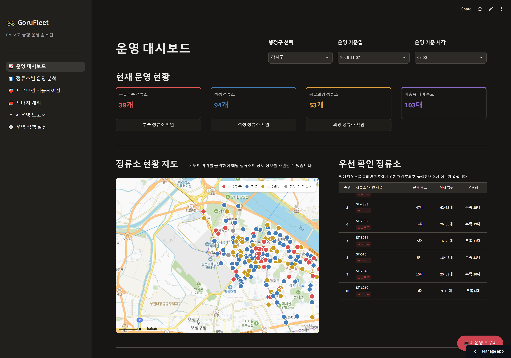
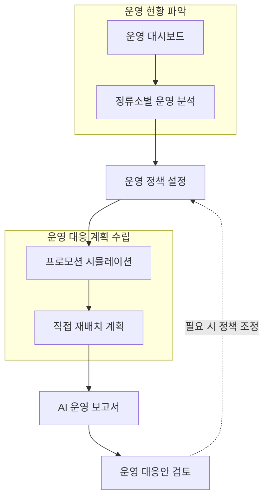
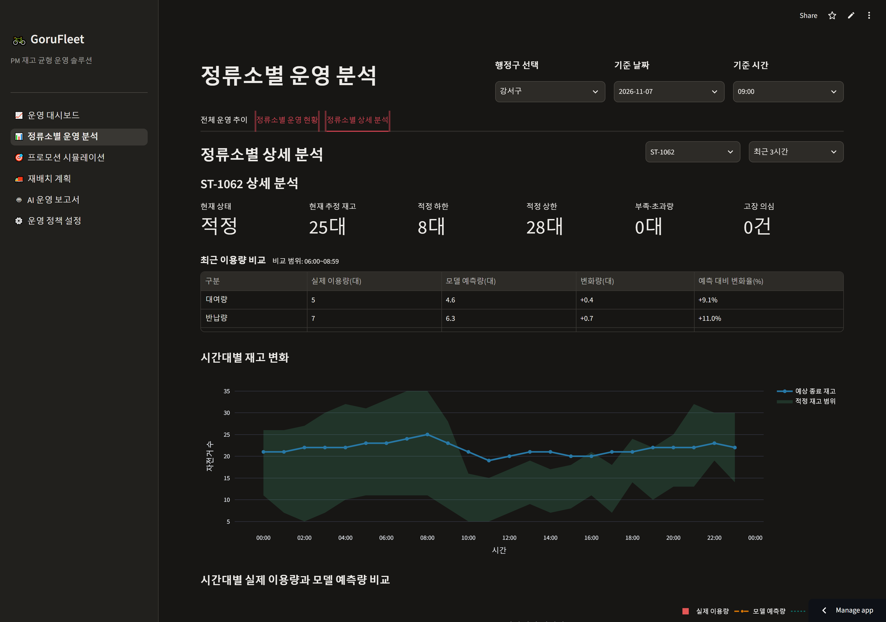
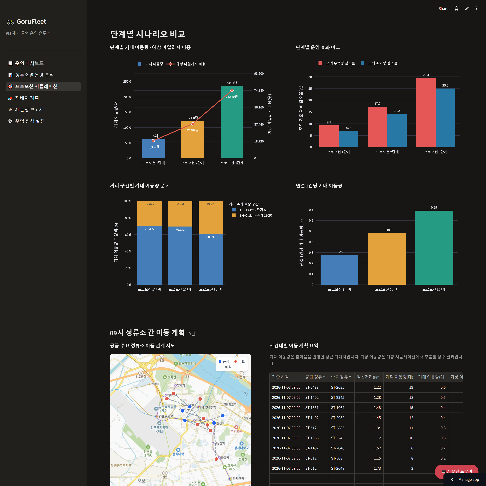
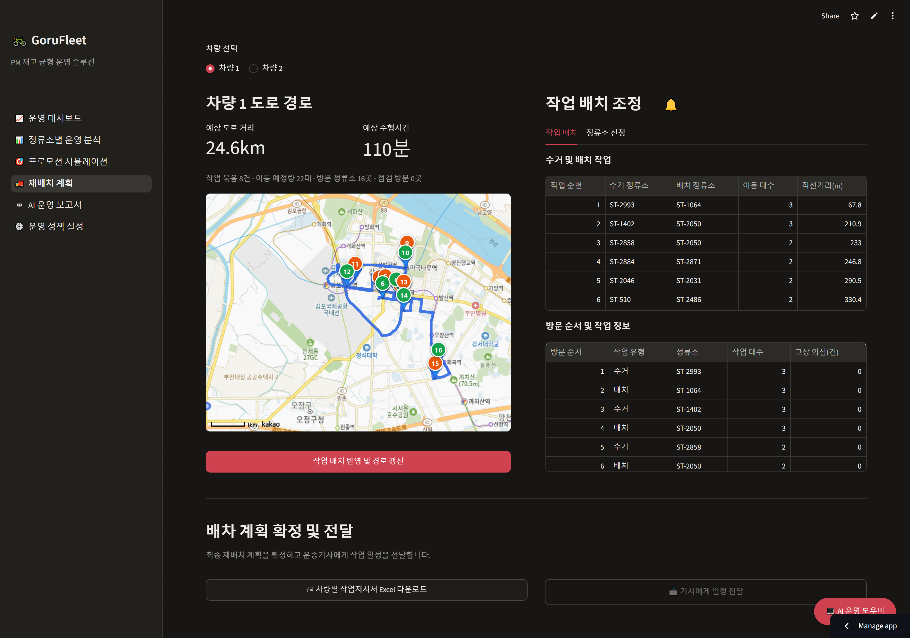
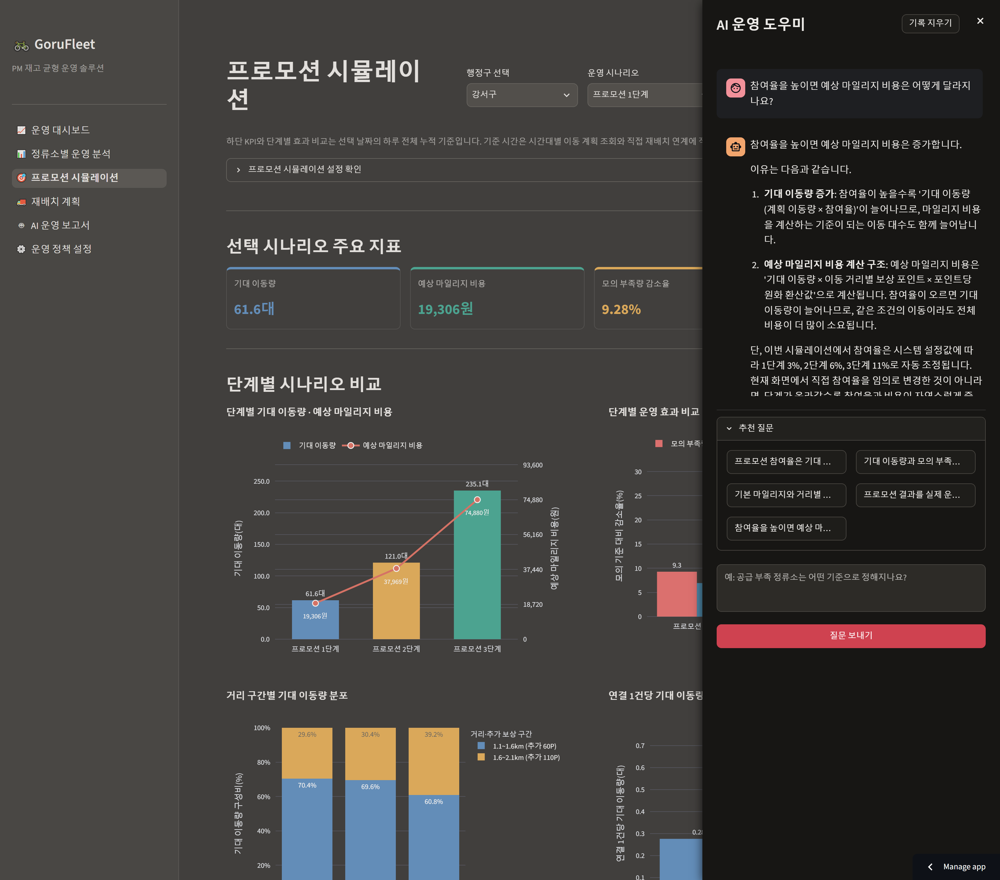
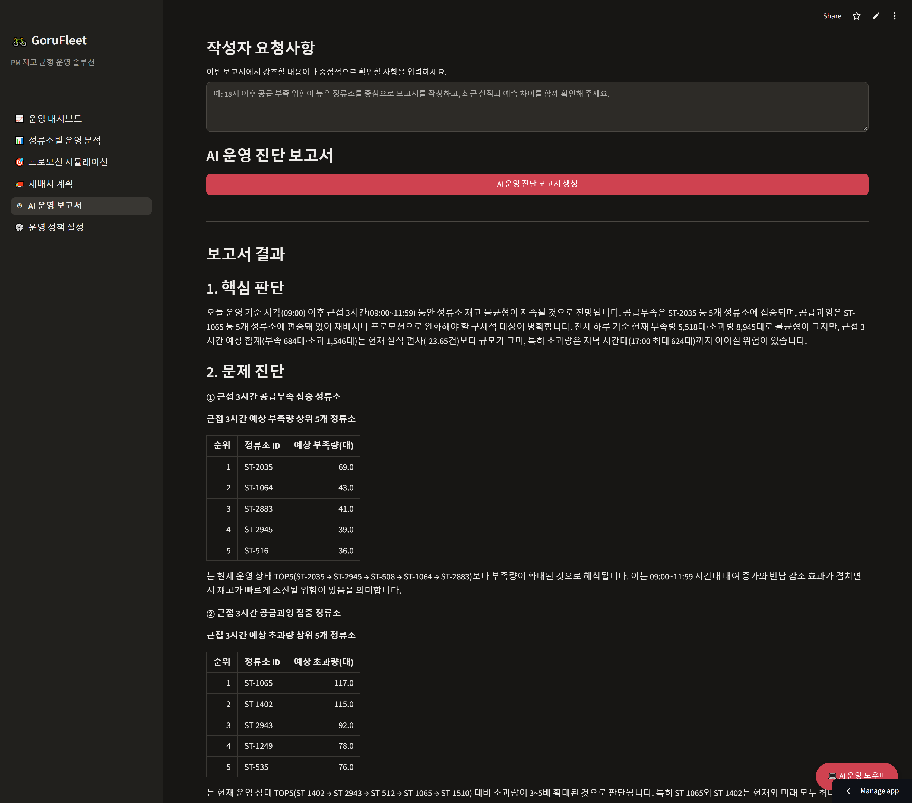
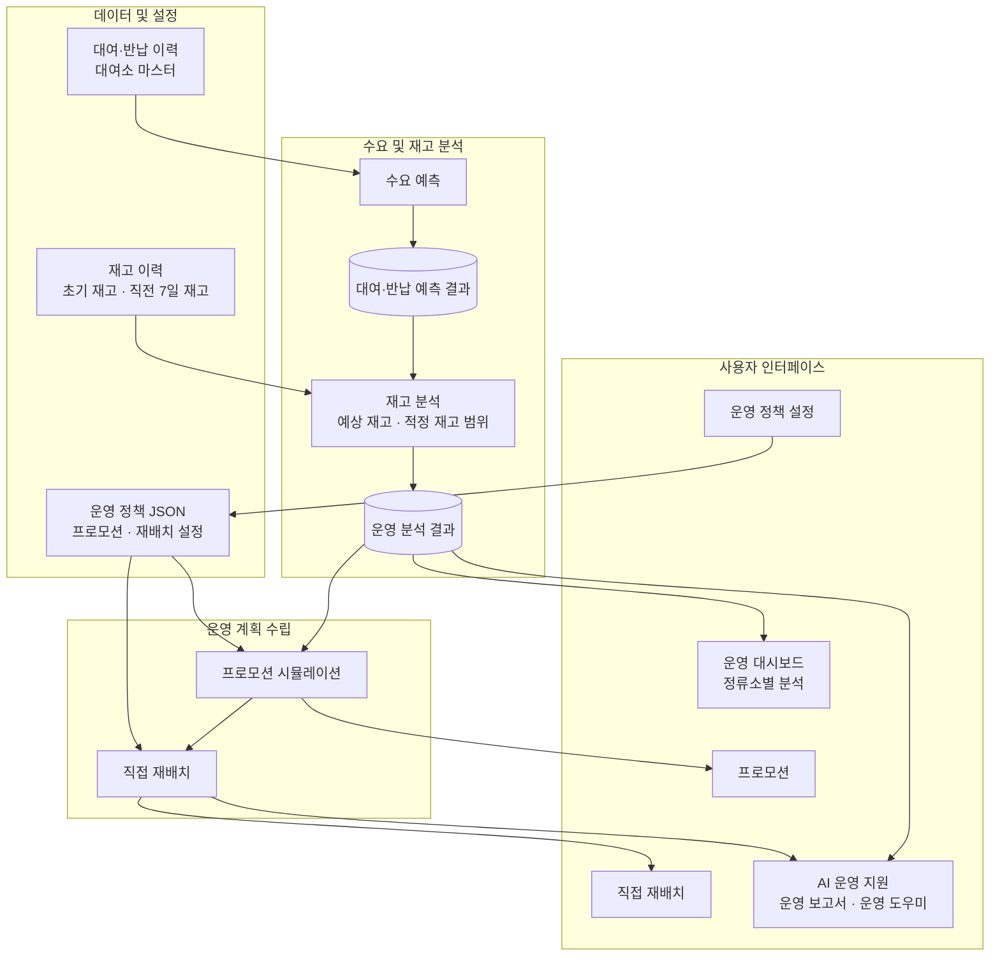

# GoruFleet(고르플릿): **PM 재고 균형 운영 솔루션**

지역·시간대별 재고 불균형을 분석하고, 이용자 참여형 프로모션과 직접 재배치 계획을 통해 **운영 담당자의 의사결정을 지원하는 솔루션입니다.**

---

## 1. 프로젝트 개요

### 프로젝트 목적

PM 운영 과정에서 발생하는 지역·시간대별 재고 불균형 문제를 데이터 기반으로 분석하고, 운영 담당자의 재고 균형 의사결정을 지원하는 솔루션 **GoruFleet**을 구현했습니다.

수요 예측을 기반으로 거점별 운영 현황을 파악하고, 재고 과잉 거점에서 부족 거점으로 이용자의 이동을 유도하는 프로모션 시나리오를 설계합니다. 또한 프로모션 이후에도 남아 있는 재고 불균형을 해소할 수 있도록 직접 재배치 계획을 제공합니다.

### 기획 대상 사용자

**민간 PM 운영사의 운영 담당자**

- 거점별·시간대별 수요 및 재고 현황 파악
- 수요 변화에 따른 운영 대응 우선순위 판단
- 프로모션 운영 여부 및 보상 조건 결정
- 프로모션 이후 잔여 재고 불균형에 대한 재배치 계획 수립

### 프로젝트 범위 및 데이터 활용

본 프로젝트는 서울시 공공자전거 따릉이의 공개 데이터를 활용하여 민간 PM 운영 환경을 가정하고 제작한 개인 포트폴리오 프로젝트입니다.

실제 민간 PM 운영사의 내부 데이터를 확보하기 어려운 점을 고려해 공개 대여 이력을 대체 데이터로 활용했으며, 이를 바탕으로 수요 예측, 재고 분석, 프로모션 시뮬레이션 및 재배치 계획 수립 기능을 구현했습니다.

*실제 운영사에 납품하거나 현장에 적용한 서비스는 아니며, 공개 데이터를 기반으로 운영 문제를 정의하고 의사결정 지원 로직을 구현하는 데 목적을 두었습니다.*

## 2. 문제 정의 및 기획 배경

### 공유 PM 시장과 운영 환경

국내 공유형 PM 시장은 초기 성장 이후 기업 간 경쟁 심화와 규제 환경 변화 등을 겪으며 시장이 재편됐습니다. 삼정KPMG의 2025년 시장 분석에 따르면 국내 공유형 마이크로 모빌리티 기업의 주요 과제로 수익성 악화와 운영 효율성 저하를 지적하고 있습니다.

이러한 환경에서 운영사는 신규 이용자 확보뿐 아니라 기기 운영에 필요한 비용을 관리하고, 한정된 운영 자원을 효율적으로 활용하는 것이 중요해지고 있습니다.

### 운영사의 핵심 문제: 지역·시간대별 재고 불균형

PM 이용 수요는 지역의 특성과 시간대에 따라 달라집니다. 예를 들어 출근 시간에는 주거 지역에서 업무·산업 지역이나 대중교통 거점으로 이동 수요가 집중되는 반면, 주간에는 상업·업무 시설이나 생활 편의시설 주변으로 수요가 옮겨갈 수 있습니다. 이처럼 시간대별 이동 방향과 수요 발생 지역이 바뀌면 일부 정류소에서는 재고 부족이, 다른 정류소에서는 재고 과잉이 발생할 수 있습니다.

이러한 불균형이 반복되면 이용자가 원하는 위치에서 기기를 이용하기 어려워지고, 운영사는 수요가 발생하는 지역에 적절한 공급량을 유지하기 위한 추가적인 관리 업무를 수행해야 합니다.

### 기존 대응 방식의 부담

운영사는 재고가 부족한 지역에 기기를 공급하기 위해 현장 인력과 운송 차량을 투입하여 직접 수거·재배치하는 방식으로 대응할 수 있습니다.

그러나 수요와 재고 상태는 지역과 시간대에 따라 계속 변하기 때문에 직접 재배치만으로 대응할 경우 인력, 운송 비용 및 작업 시간이 반복적으로 발생합니다. 또한 기기 수거와 이동, 주차 관리 과정에서 현장 운영 부담과 주민 불편이 발생할 가능성도 있습니다.

따라서 운영 인력의 직접 재배치에만 의존하기보다, 이용자의 자발적인 이동을 활용해 재고 불균형을 일부 완화하는 대안이 필요하다고 판단했습니다.

### 해결 방향: 이용자 참여형 재배치

GoruFleet은 직접 재배치에 집중되던 운영 부담을 줄이기 위한 대안으로 **이용자 참여형 프로모션과 직접 재배치를 결합한 운영 방식**을 기획했습니다.

먼저 시간대별 수요 예측과 재고 분석을 통해 공급이 과잉된 거점과 부족한 거점을 파악합니다. 이후 이용자가 공급 과잉 거점에서 수요 부족 거점으로 기기를 이동하도록 유도하고, 이동에 대한 보상으로 마일리지를 제공하는 프로모션 시나리오를 설계합니다.

프로모션으로 해소되지 않은 재고 불균형은 현장 인력을 통한 직접 재배치 계획으로 보완합니다. 이를 통해 이용자 참여로 대응할 수 있는 물량과 운영 인력이 직접 처리해야 하는 물량을 구분하고, 운영 담당자가 상황에 맞는 대응 방식을 선택할 수 있도록 지원합니다.

마일리지 보상은 이용자의 이동 참여를 유도하는 수단인 동시에, 장기적으로는 서비스 재이용이나 기업의 다른 서비스로 고객을 유입할 수 있는 사업적 가능성도 고려했습니다.

> **참고:** 고객 유입 및 장기 이용 효과는 본 MVP에서 검증한 성과가 아니라 향후 검증이 필요한 기대효과입니다.

---

## 3. 솔루션 구조 및 운영 프로세스

GoruFleet은 수요 예측과 재고 분석을 바탕으로 운영 현황을 파악하고, 이용자 참여형 프로모션과 직접 재배치 계획을 통해 재고 불균형에 대응하도록 설계했습니다.

### 운영 프로세스

### 화면별 의사결정 지원 기능

| 화면 | 운영 담당자의 핵심 질문 | 주요 기능 및 산출물 |
|---|---|---|
| 운영 대시보드 | 현재 전체 운영 상태는 어떠한가? | 주요 운영 KPI, 실제·예측 이용량 비교, 정류소별 운영 상태 및 지도 |
| 정류소별 운영 분석 | 어느 정류소에서 언제 재고 부족·과잉이 발생하는가? | 정류소별·시간대별 재고 현황, 적정 재고 범위, 부족·과잉 수량 및 우선순위 |
| 프로모션 시뮬레이션 | 이용자 참여를 통해 어느 정도의 재고 불균형을 대응할 수 있는가? | 참여율 및 보상 조건별 예상 이동량, 마일리지 비용, 프로모션 적용 후 재고 변화 |
| 직접 재배치 계획 | 프로모션 이후 남은 불균형을 어떻게 처리할 것인가? | 공급·수요 정류소 매칭, 작업 묶음 생성, 차량별 작업 배정, 방문 순서 및 추천 경로, 작업지시서 |
| AI 운영 보고서 | 분석 결과를 어떻게 해석하고 공유할 것인가? | 운영 현황 및 주요 위험 요약, 분석 결과 기반 AI 보고서, Word 문서 출력 |
| 운영 정책 설정 | 어떤 운영 조건을 적용할 것인가? | 프로모션 참여율·마일리지 보상 조건, 재배치 거리·최소 이동 수량·최대 작업 묶음 수 설정 |

각 화면은 메뉴에서 독립적으로 접근할 수 있는 의사결정 도구이며, 위 다이어그램은 일반적인 활용 흐름과 기능 간 데이터 관계를 나타냅니다. 단, 직접 재배치 계획은 선택한 프로모션 단계의 결과를 입력 데이터로 사용합니다.

### 주요 화면
정류소별 운영 분석

프로모션 시뮬레이션

재배치 계획

AI 운영 도우미

AI 운영 보고서

---

## 4. 주요 기획 및 문제 해결 사례

프로젝트 초기에는 이용 패턴과 정류소 간 연결 관계를 분석하는 방식으로 운영 문제를 해결하고자 했습니다. 그러나 실제 데이터를 분석하고 기능을 구현하는 과정에서 초기 접근 방식만으로는 정류소별 재고 불균형을 정량적으로 판단하기 어렵다는 점을 확인했습니다.

이에 따라 데이터의 특성과 실제 운영 과정에서 필요한 의사결정 기준을 고려해 분석 방식과 운영 로직을 단계적으로 개선했습니다.

### 4-1. 분석 방향 전환: 네트워크 분석에서 수요량 예측으로

**문제 및 대응**

초기에는 네트워크 분석을 통해 정류소 간 연결 관계와 이용 패턴을 파악하고, 이를 바탕으로 정류소 유형을 구분하는 방식을 구상했습니다.

그러나 운영 담당자가 재고 불균형에 대응하려면 정류소의 유형보다 시간대별 예상 대여량과 반납량, 그리고 그에 따른 재고 부족·과잉 규모를 파악하는 것이 더 중요하다고 판단했습니다.

이에 정류소 간 관계 분석 대신 정류소별·시간대별 대여량과 반납량을 예측하는 방식으로 전환했습니다. 예측 모델은 최근 90일의 이용 데이터를 학습하고, 마지막 14일을 별도 검증 기간으로 설정했습니다. 초기 검토했던 날씨 변수는 검증 과정에서 예측 성능 개선 효과가 제한적이어서 제외했습니다.

**구현 결과**

**대여량과 반납량을 각각 예측하는 Random Forest 모델을 구현했습니다.** 이를 통해 정류소 유형 분류 중심의 분석에서 벗어나, 시간대별 수요 변화와 재고 불균형을 정량적으로 파악할 수 있는 기반을 마련했습니다.

### 4-2. 재고 판단 기준 설계: 대여·반납량에서 실제 재고 기준으로

**문제 및 대응**

대여량과 반납량은 정류소에서 발생한 이동량이므로, 예측 결과만으로는 현재 재고가 충분한지 또는 어느 수준까지 확보해야 하는지 판단하기 어려웠습니다.

이를 보완하기 위해 서울시 공공자전거 API에서 예측 기준일 00시의 초기 재고를 수집하고, 직전 7일간의 시간대별 재고 이력을 추가로 활용하도록 설계했습니다. 이를 바탕으로 정류소별·시간대별 재고 분포를 분석해 적정 재고의 하한과 상한을 산출하도록 변경했습니다.

**구현 결과**

**초기 재고와 시간대별 대여·반납 예측량을 결합해 재고 변화를 시뮬레이션**하고, 정류소별 재고를 적정 범위와 비교해 공급 부족 및 과잉 상태를 판단할 수 있도록 구현했습니다.

### 4-3. 재배치 계획 개선: 이론적 최적화에서 운영 조건을 반영한 매칭으로

**문제 및 대응**

초기에는 공공자전거 재배치 관련 연구를 참고해 차량 이동 거리와 작업량을 고려하는 알고리즘을 구현하고자 했습니다. 하지만 연구 알고리즘을 현재 프로젝트의 데이터와 구현 범위에 그대로 적용하기 어려웠고, 초기 매칭 결과에서도 과도한 재배치 작업이 생성되는 문제가 있었습니다.

이에 공급 정류소와 수요 정류소의 조합을 생성한 뒤, 직선거리가 가까운 조합부터 순차적으로 매칭하는 탐욕적 방식으로 변경했습니다. 또한 최대 이동 거리, 최소 이동 수량, 최대 작업 묶음 수를 운영 설정으로 분리해 작업량을 제한하도록 설계했습니다.

**구현 결과**

매칭된 작업을 **2대의 차량에 배정하고, Kakao Mobility API를 활용해 차량별 도로 주행 추천 경로를 확인할 수 있도록 구현**했습니다. 또한 **차량별 방문 정류소를 운영자가 직접 편집**해 필요에 따라 방문 대상을 조정할 수 있도록 했습니다. 이를 통해 전체 경로의 최적성을 보장하기보다, 작업량과 이동 거리 등 운영 조건을 반영한 재배치 계획을 생성하도록 구성했습니다.

### 4-4. 프로모션 시뮬레이션 설계: 불확실한 참여율을 고려한 시나리오 구성

**문제 및 대응**

이용자의 자발적인 이동을 유도하는 프로모션을 구상했지만, 실제 운영 데이터가 없는 상황에서 참여율을 사전에 확정하기 어려웠습니다. 또한 참여율과 이동 거리에 따른 보상 수준에 따라 예상 이동량과 마일리지 지급 비용이 달라질 수 있었습니다.

이에 실제 참여율을 예측하는 대신 **3%, 5%, 10%를 가정 시나리오로 설정했습니다. 운영 담당자가 참여율 단계와 마일리지 보상 조건, 이동 거리에 따른 추가 보상 기준을 직접 조정할 수 있도록 설계**했습니다.

**구현 결과**

참여율과 보상 조건을 달리한 프로모션 시나리오를 비교하고, 조건별 예상 이동량과 마일리지 지급 비용을 확인할 수 있도록 구현했습니다. 또한 **참여 이동량을 반영한 재고 시뮬레이션을 통해 프로모션 적용 전후의 재고 불균형 변화를 확인할 수 있도록 구성**했습니다.

---

<strong>5. 시스템 아키텍처 및 기술 구현</strong>

### 5-1. 시스템 아키텍처

GoruFleet은 공공자전거 대여·반납 이력과 정류소 정보를 기반으로 수요를 예측하고, 별도의 재고 데이터를 결합해 운영 분석 결과를 생성합니다. 분석 결과는 프로모션 및 재배치 로직으로 전달되며, 최종 결과는 Streamlit 화면에서 확인할 수 있도록 구성했습니다.

### 5-2. 핵심 기술 스택

| 구분 | 기술 | 활용 목적 |
|---|---|---|
| 개발 언어 | Python | 데이터 처리, 예측 모델 및 운영 로직 구현 |
| 애플리케이션 | Streamlit | 멀티페이지 대시보드 및 사용자 인터페이스 구성 |
| 데이터 처리 | Pandas, NumPy | 데이터 정제, 시간대별 집계, 재고·프로모션 시뮬레이션 |
| 머신러닝 | Scikit-learn | Random Forest 기반 대여·반납량 예측 및 성능 평가 |
| 데이터 시각화 | Plotly | 이용량, 재고 변화 및 운영 지표 시각화 |
| API 통신 | Requests | 서울시 및 카카오모빌리티 API 요청 |
| 모델 저장 | Joblib | 학습된 예측 모델 저장 및 로드 |
| LLM 연동 | OpenAI Python SDK, NVIDIA API | 운영 분석 결과 기반 AI 보고서 및 질의응답 생성 |
| 문서 출력 | python-docx, openpyxl | AI 보고서 Word 파일 및 재배치 작업지시서 Excel 파일 생성 |

### 5-3. 외부 서비스 연동

| 서비스 | 활용 기능 |
|---|---|
| 서울시 공공자전거 OpenAPI | 예측 기준 시각의 초기 재고 및 과거 시간별 재고 이력 수집 |
| Kakao Mobility Directions API | 차량별 방문 순서를 기준으로 도로 주행 추천 경로 조회 |
| Kakao Maps JavaScript SDK | 대여소 위치, 공급·수요 정류소 및 재배치 경로 지도 시각화 |
| NVIDIA API | 운영 지표 및 분석 결과를 바탕으로 AI 보고서와 질의응답 생성 |

### 5-4. 핵심 모듈별 구현 방식

| 핵심 모듈 | 주요 파일 | 구현 내용 |
|---|---|---|
| 수요 예측 | `daily_model_pipeline.py` `demand_predictor.py` | 대여·반납 데이터를 정류소별·시간대별로 집계하고, 대여 예측 모델과 반납 예측 모델을 별도로 학습합니다. Random Forest와 범주형 변수 인코딩을 적용해 수요를 예측합니다. |
| 재고 시뮬레이션 및 운영 분석 | `operations_simulator.py` `rolling_operations.py` | 초기 재고와 시간대별 대여·반납 예측량을 결합해 재고 변화를 계산합니다. 최근 7일간의 시간별 재고 이력을 활용해 적정 재고 범위를 산출하고, 실제 이용 실적과 예측 결과를 비교합니다. |
| 프로모션 시뮬레이션 | `promotion_simulator.py` `promotion_settings_ui.py` | 공급 과잉·부족 정류소와 이동 거리 조건을 바탕으로 프로모션 대상 조합을 생성합니다. 참여율 가정과 마일리지 보상 조건을 적용해 기대 이동량, 모의 이동량 및 예상 비용을 비교합니다. |
| 직접 재배치 계획 | `relocation_planner.py` `relocation_settings.py` `route_api.py` | 프로모션 이후 잔여 공급·수요를 가까운 정류소 조합부터 순차적으로 매칭합니다. 최대 이동 거리, 최소 이동 수량, 최대 작업 묶음 수를 적용하고, 작업을 2대의 차량에 배정한 뒤 방문 순서에 따른 도로 경로를 조회합니다. |
| AI 운영 보고서 | `pages/ai_report.py` | Python에서 계산한 운영 지표와 분석 결과를 구조화해 NVIDIA API에 전달하고, 사전에 정의한 보고서 구성에 따라 자연어 분석 내용을 생성합니다. Word 문서 출력 기능을 제공합니다. |
| AI 운영 도우미 | `operations_assistant.py` | 현재 화면의 맥락과 프로젝트 정보를 반영해 운영 관련 질문에 답변하는 대화형 도우미를 구현합니다. |
| 사용자 인터페이스 | `pages/` 내 각 화면 모듈 | 운영 대시보드, 정류소별 운영 분석, 프로모션, 재배치, AI 보고서, 운영 정책 설정 화면을 구성하고 Plotly 차트와 지도 컴포넌트를 통해 결과를 제공합니다. |

### 5-5. 수요 예측 모델 검증 결과

대여량과 반납량은 각각 별도의 Random Forest 모델로 예측했습니다. 최근 90일의 데이터를 기준으로 마지막 14일을 시간 순서에 따라 분리해 검증했으며, MAE, RMSE, R²를 사용해 성능을 평가했습니다.

| 예측 대상 | MAE | RMSE | R² |
|---|---:|---:|---:|
| 대여량 예측 | 1.4404 | 2.4845 | 0.7525 |
| 반납량 예측 | 1.3662 | 2.3694 | 0.7842 |

**검증 조건**

- 학습 데이터 기간: 2026.08.01 ~ 2026.10.29
- 검증 기간: 2026.10.16 ~ 2026.10.29 (14일)
- 입력 변수: 정류소 ID, 시간대, 요일
- 평가 단위: 정류소·시간대별 대여 및 반납 건수

*2026년 10월 30일 실행 당시의 검증 결과이며, MAE와 RMSE는 정류소·시간대별 건수 기준입니다. 단일 검증 구간의 결과이므로 다른 지역이나 실제 민간 PM 운영 환경에서 동일한 성능을 보장하지는 않습니다.*

---

<strong>6. 프로젝트 한계 및 향후 개선 방향</strong>

GoruFleet은 공공자전거 데이터를 활용해 PM 운영사의 재고 균형 관리 과정을 구현한 MVP입니다. 실제 운영 환경과 데이터 구조가 다르기 때문에 일부 기능은 가정한 조건을 기반으로 설계했으며, 향후 다음 방향으로 개선할 수 있습니다.

### 1. 데이터 범위 및 적용 지역의 한계

현재는 민간 PM 운영사의 실제 운영 데이터를 확보하기 어려워 서울시 따릉이 데이터를 대체 데이터로 활용했습니다. 또한 분석 범위를 강서구로 한정했기 때문에 실제 PM 운영 환경에서 발생하는 다양한 지역적 특성과 운영 패턴을 충분히 반영하지 못합니다.

**향후 개선 방향:** 강서구와 인접한 행정구를 시작으로 분석 지역을 단계적으로 확대하고, 지역별 이용 패턴과 재고 불균형 특성을 비교해 적용 범위를 넓힐 계획입니다. 실제 운영 데이터가 적법한 절차를 통해 확보되는 경우에는 별도의 검증을 거쳐 현장 적용 가능성을 평가할 수 있습니다.

### 2. 수요 예측 및 프로모션 정책 고도화

현재 수요 예측은 대여소별 과거 이용량, 시간대, 요일 정보를 중심으로 구성했습니다. 기상·공휴일·행사 등 외부 요인을 충분히 반영하지 못했으며, 프로모션 참여율도 실제 참여 데이터가 아닌 가정값을 사용합니다. 따라서 예측 결과와 프로모션 시뮬레이션은 운영 의사결정을 지원하기 위한 참고 자료이며, 실제 참여율이나 운영 비용 절감 효과를 검증한 결과는 아닙니다.

**향후 개선 방향:** 추가로 활용할 수 있는 외부 변수를 검토하고, 검증 데이터 기준으로 변수별 예측 성능을 비교할 계획입니다. 또한 지역·시간대별 재고 불균형 수준에 따라 보상 수준을 차등 적용하고 예산 한도를 반영하는 방식으로 프로모션 정책을 고도화할 수 있습니다.

### 3. 재배치 작업 및 경로 최적화

현재 재배치 계획은 공급 대여소와 수요 대여소 간 거리를 기준으로 작업을 배정하는 탐욕적 매칭 방식입니다. 이후 두 대의 차량에 작업을 배정하고 Kakao Mobility API의 추천 경로를 활용하지만, 차량의 출발·복귀 거점이나 전체 작업을 아우르는 최적 경로까지 고려하지는 않습니다.

**향후 개선 방향:** 차량별 출발지와 복귀지를 포함하고, 여러 작업 지점을 하나의 경로로 연결하는 차량 경로 최적화 알고리즘을 적용할 수 있습니다. 이때 작업 우선순위, 차량별 적재량, 이동 거리 등을 함께 고려해 실제 현장 운영에 적합한 재배치 계획으로 발전시킬 수 있습니다.

### 4. 비거치형 PM 운영 환경으로의 확장

현재 GoruFleet은 대여·반납 거점이 정해진 대여소 기반 공공자전거 운영 구조를 전제로 합니다. 반면 비거치형 PM은 기기가 특정 대여소에 고정되지 않기 때문에 기존 대여소 단위의 재고 분석 및 재배치 방식을 그대로 적용하기 어렵습니다.

**향후 개선 방향:** H3 기반 공간 격자를 활용해 서비스 지역을 일정한 공간 단위로 구분하고, 격자별 수요와 기기 분포를 분석하는 방식으로 확장할 수 있습니다. 이를 위해서는 기기의 위치 정보와 주차 가능 구역 등 공간 관련 데이터가 함께 고려되어야 합니다.

### 5. AI 운영 보고서의 활용성 개선

현재 AI 운영 보고서는 Python에서 산출한 운영 지표와 분석 결과를 외부 LLM에 전달하고, 사전에 정의한 프롬프트와 보고서 구조에 따라 생성합니다. 따라서 운영 담당자가 필요로 하는 지표나 보고서 양식을 자유롭게 선택하는 데에는 한계가 있습니다.

**향후 개선 방향:** 운영 목적과 담당 업무에 따라 보고서 양식을 구분하고, 주요 KPI와 분석 항목을 선택할 수 있도록 발전시킬 계획입니다. 이를 통해 단순한 분석 결과 요약을 넘어 운영 담당자의 의사결정과 후속 조치에 직접 활용할 수 있는 보고 기능을 목표로 합니다.

---

<strong>참고 자료</strong>

### 시장 및 운영 환경

- [삼정KPMG, 마이크로 모빌리티 시장, 재도약을 위한 전략적 방향 (2025)](https://kpmg.com/kr/ko/insights/eri/2025/businessfocus-0730.html)
- 개인형 이동장치 대여 요금 분석 보고서 - 공유 킥보드 중심으로 — 한국소비자단체협의회 (2025.01)

### 선행 연구

- [공공 자전거 재배치 문제에 대한 동적 재고-경로 접근방법: 서울시 사례 연구](https://www.jkiie.org/_PR/view/index.php?aidx=49738&bidx=4466) — 고정윤, 김승택, 이정현, 이충목 (2026)
- [공유자전거 따릉이 재배치를 위한 실시간 수요예측 모델 연구](https://www.kci.go.kr/kciportal/landing/article.kci?arti_id=ART003013163) — 김유신 (2023)
- [공공자전거 이용패턴 분석을 위한 데이터마트 설계 및 구축 연구](https://kasba.or.kr/uploads/papers/NODE10611696.pdf) — 백가은, 조재희

### 데이터 및 API

- [서울시 공공자전거 대여정보](https://data.seoul.go.kr/dataList/OA-21229/F/1/datasetView.do)
- [서울시 공공자전거 대여소 마스터 정보](https://data.seoul.go.kr/dataList/OA-21235/S/1/datasetView.do)
- [Kakao Mobility Directions API](https://developers.kakaomobility.com/guide/navi-api/start.html)
- [Kakao Mobility 다중 경유지 길찾기 API](https://developers.kakaomobility.com/guide/navi-api/waypoints.html)

